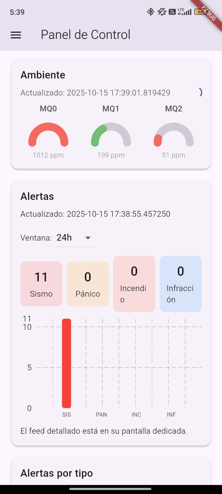
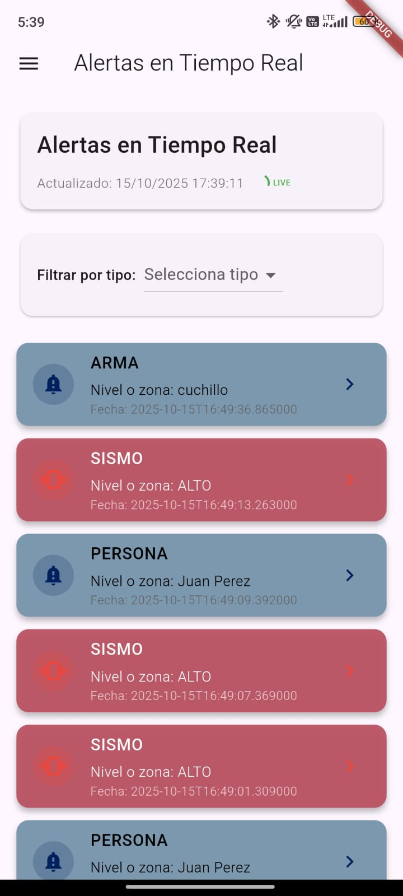
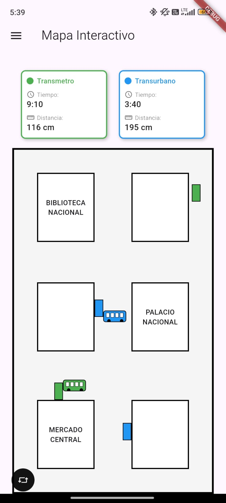

# Smart City IoT — traffic and public safety for Guatemala City's historic center

A traffic and public safety system built in three phases, using Guatemala City's Zona 1 historic center as the case study. Arduino sensors report traffic, air quality, fires, earthquakes, panic buttons and red-light violations. A Raspberry Pi publishes the readings over MQTT, a FastAPI service stores them in MongoDB, and a Flutter app shows them live with alerts. In the last phase, computer vision models (YOLOv8 and face recognition) detect weapons, license plates and people on a watch list.

Team project for *Arquitectura de Computadores y Ensambladores 2* (Universidad de San Carlos de Guatemala, 2nd semester 2025).


## Architecture

```text
Arduino sensors ──serial──► Raspberry Pi (Python) ──MQTT──► broker ──► FastAPI + MongoDB ──REST──► Flutter app
 ultrasonic · MQ-135                                                       ▲
 panic buttons · piezo                                                     │ alerts
 traffic lights · buzzers                Cameras ──► YOLOv8 / face_recognition
```

| Phase | What was added |
|---|---|
| [`fase1`](fase1/) | Model of the area with Arduino: vehicle flow (HC-SR04), gases (MQ-135), panic buttons, simulated earthquakes, traffic lights and a real-time dashboard in Processing |
| [`fase2`](fase2/) | Raspberry Pi gateway, MQTT, FastAPI + MongoDB backend, Flutter app, and 3D-printed parts for the physical prototype |
| [`fase3`](fase3/) | Computer vision: weapon detection, license plate detection with a custom YOLOv8 model, face recognition against a watch list, alerts in the app, an interactive map, and QR codes that open tourist landing pages |

## Stack

C++ (Arduino) · Python (Raspberry Pi, FastAPI, Ultralytics YOLOv8, OpenCV, face_recognition) · MQTT (paho-mqtt) · MongoDB (motor) · Flutter / Dart · Processing · 3D printing

## Screens

| Control panel | Real-time alerts | Interactive map |
|---|---|---|
|  |  |  |

## Docs (Spanish)

- [Technical manual](fase3/docs/Technical/Technical_manual.md), [diagrams](fase3/docs/Technical/DIAGRAMAS.pdf) and [IoT stack](fase3/docs/Technical/STACK%20IOT%20FRAMEWORK.pdf)
- [User manual](fase3/docs/User/User_Manual.md)
- Weekly reports in `fase*/weekly/` and `fase1/docs/weekly/`
