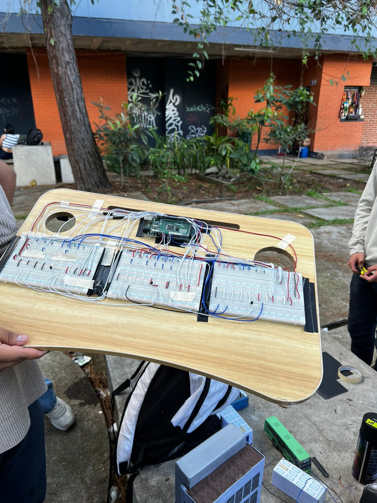
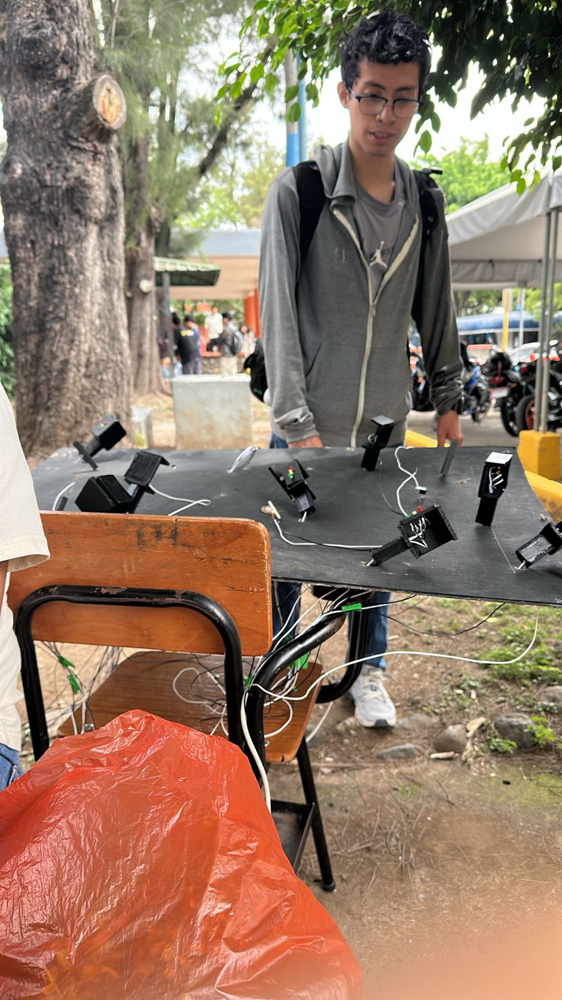
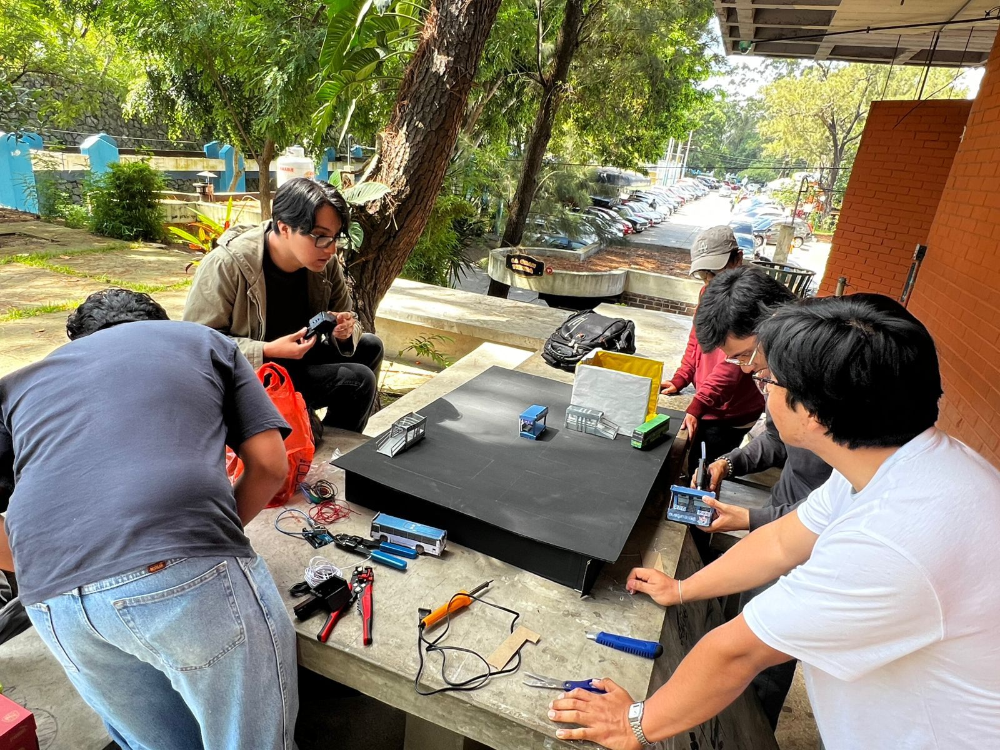
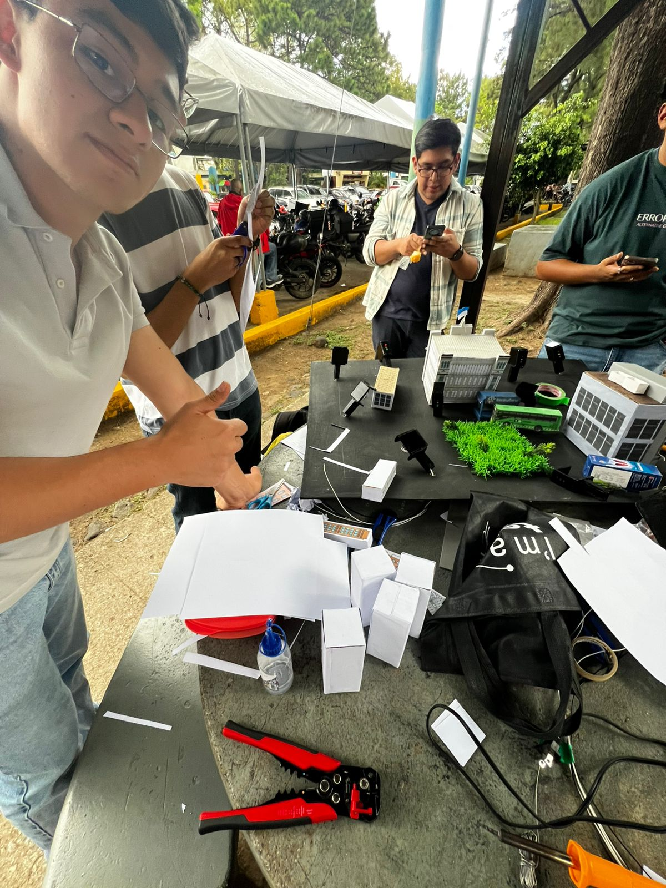

---

## **Reporte Semanal – Semana 2**

**Objetivo de la semana:**
Encapsular el circuito principal y terminar la construccion de la maqueta para poder integrar todos los componentes ademas completar la decoracion, realizar el cableado interno, conectar los sensores de movimiento, presion y gas así como instalar los LEDs en cada semaforo y los botones de panico ya en la maqueta, todos interconectados al circuito central mediante tres protoboards.

---

### **Resumen general de avances**

Durante esta semana el equipo se enfoco en la consolidacion del sistema electronico dentro de la maqueta y en la conexion definitiva de los sensores y actuadores al igual que en el reforzamiento de la base y superficie de la maqueta.

Los avances mas importantes fueron:

* **Encapsulamiento del circuito principal:** Se organizo la electronica en tres protoboards cada uno con una funcion específica y con sensores especificos:

  * Uno para los **buffers y botones de panico**, los cuales activaban un sonido al ser presionados.

  * Otro para los **LEDs de los semaforos**, sincronizados a través del Arduino con la logica programada.
  
  * Y uno adicional para los **sensores de movimiento, presion y gas**, encargados de la deteccion en la maqueta.

* **Cableado interno:** Se completo gran parte de la conexion de sensores y LEDs hacia el circuito ubicado en la parte inferior de la maqueta.

* **Instalacion de sensores y botones de panico:** Se integraron de forma definitiva  sus posiciones de trabajo para asegurar su funcionamiento en la maqueta fisica.

* **Decoracion y refuerzo de la maqueta:** Se termino la decoracion de calles, edificios y paradas ademas de reforzar ciertas areas debiles para mejorar la estabilidad estructural.

* **Pruebas iniciales de integracion:** Se verifico el funcionamiento de LEDs, sensores y botones tras su conexion al circuito encapsulado.

* **Ajustes de software:** Se hicieron correcciones menores tanto en el codigo de Arduino como en Processing para asegurar la correcta comunicacion y respuesta de los elementos.

---

### **Aportes individuales**

#### **DANIEL ANDREE HERNANDEZ FLORES**

* Realizo las pruebas de conexion de los sensores de movimiento en la maqueta.
* Apoyo en el armado del circuito principal en protoboard.
* Probo el codigo de Arduino tras la integracion para verificar que la logica de control respondiera correctamente.

#### **EDUARDO SEBASTIAN GUTIERREZ FELIPE**

* Encargado de conectar y probar los LEDs de los semaforos en el protoboard.
* Ajusto detalles en la logica de sincronizacion de los semáforos en Arduino.
* Verifico la alimentacion y continuidad del cableado hacia los actuadores.

#### **ABDIEL FERNANDO JOSÉ OTZOY OTZÍN**

* Hizo pruebas de recepcion de datos en Processing tras la conexion con Arduino.
* Ajusto pequeños errores en la visualizacion de alertas en el panel de monitoreo.
* Colaboro en la conexion de los botones de panico al circuito principal.

#### **GABRIEL ANDRES MELGAR ARAGoN**

* Superviso la colocacion y orientacion de los sensores de gas y presion.
* Apoyo en la reorganizacion de cables dentro de la maqueta.
* Reviso el funcionamiento de los buffers en el protoboard dedicado.

#### **CHRISTIAN DAVID CHINCHILLA SANTOS**

* Reforzo la estructura de la maqueta en areas debiles de la base.
* Ayudo a corregir problemas de espacio para acomodar sensores y cableado.
* Coordino el encapsulamiento del circuito en la parte inferior de la maqueta.

#### **ENGEL EMILIO COC RAXJAL**

* Coloco los botones de pánico en la maqueta y los conecto al protoboard.
* Termino la decoracion de rutas, paradas y señalizacion.
* Apoyo en la verificacion del funcionamiento de LEDs y sensores tras la conexion casi final.

#### **JHONATAN IVAN GUOZ TUBAC**

* Se encargo de modificar la maqueta para mejorar el espacio de funcionamiento de los sensores.
* Elaboro detalles decorativos adicionales y reforzo algunos elementos estructurales.
* Apoyo en la organizacion del cableado interno.

#### **DANIEL ABRAHAM ORTIZ CHINCHILLA**

* Realizo pruebas de los sensores de gas y movimiento tras la conexion.
* Ayudo a instalar los semaforos y verificar su orientacion.
* Apoyo en la integracion de los protoboards con el Arduino principal.

#### **BRYAN JOSUÉ CORONADO LAINEZ**

* Documento el proceso de encapsulamiento del circuito y la conexion de protoboards.
* Hizo pruebas de comunicacion general entre Arduino y Processing.
* Apoyo en la reorganizacion de cableado para mantener la estética de la maqueta.

---

### **Dificultades encontradas**

* La maqueta estaba construida con carton rigido que se fue deteriorando por el transporte lo que provoco que se debilitara la superficie donde iban colocados sensores y semaforos aparte la base tambien es inestrable causando desconexiones en las protoboars las cuales se encuentran en la parte de abajo (base) con los sensores y leds de los semaforos que estan el la superficie .

* La caja base era poco resistente y a pesar de los refuerzos no brindaba la estabilidad suficiente.

* Problemas con la longitud de los cables ya que algunos no alcanzaban desde los sensores hasta el circuito principal complicando la conexion y provocando atrasos.

* Se requirio reorganizar parte del cableado para facilitar el encapsulamiento sin afectar la estetica.

* El avance fue mas limitado de lo esperado debido a los parciales y entregas de proyectos de otros cursos, lo cual redujo el tiempo de trabajo en equipo.

---

### **Tareas pendientes para la proxima semana**

1. Reforzar la base y la superficie de la maqueta para mejorar su estabilidad y soporte de sensores.

2. Completar la instalacion de cableado interno y encapsulamiento de componentes.

3. Realizar pruebas completas de integracion Arduino + Processing directamente en la maqueta.

4. Documentar los resultados de las pruebas y preparar material visual para la entrega de Fase 1.

5. Terminar la decoracion y costruccion de la maqueta para hacer pruebas finales con los sensores.

---

### Evidencia Fotografica

