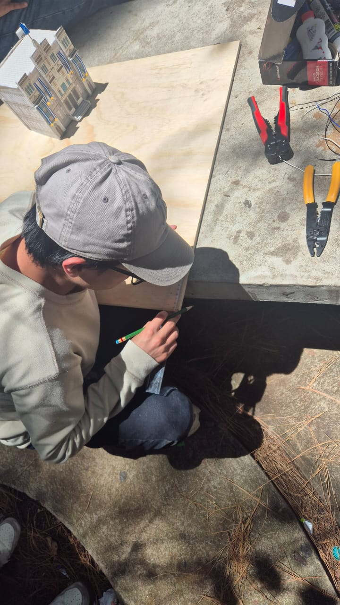
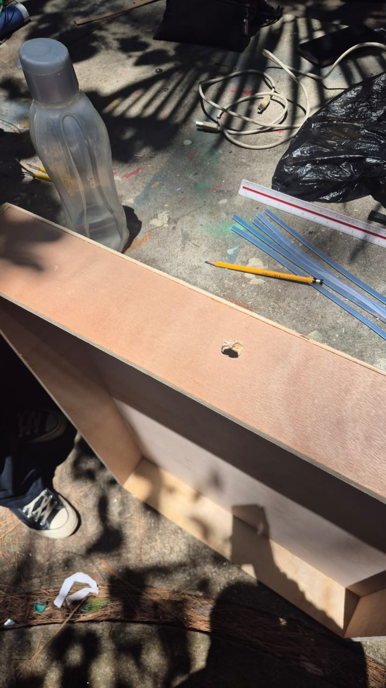
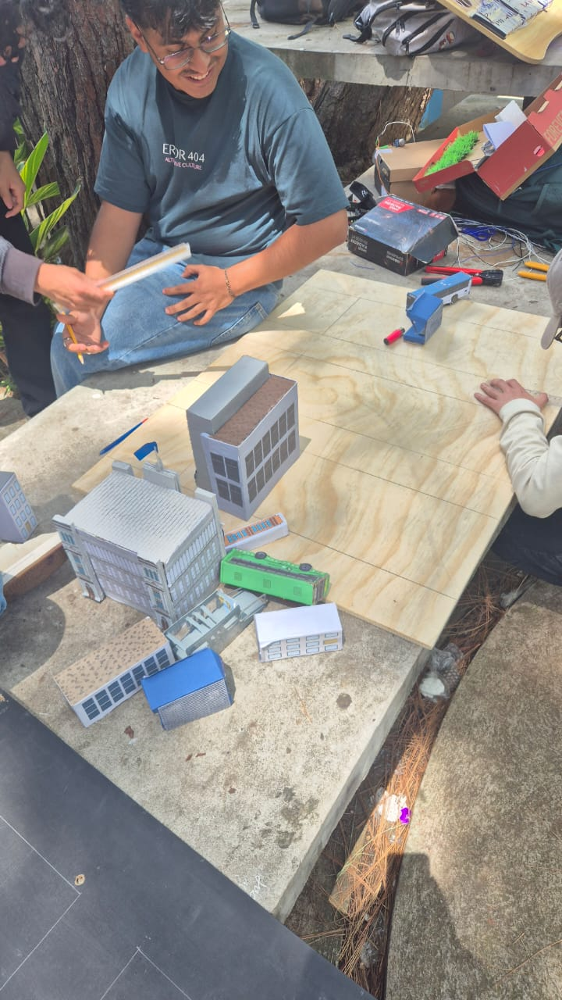
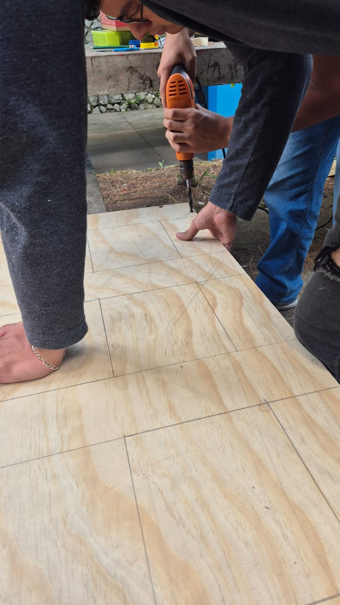
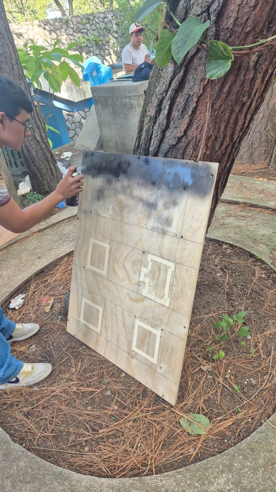
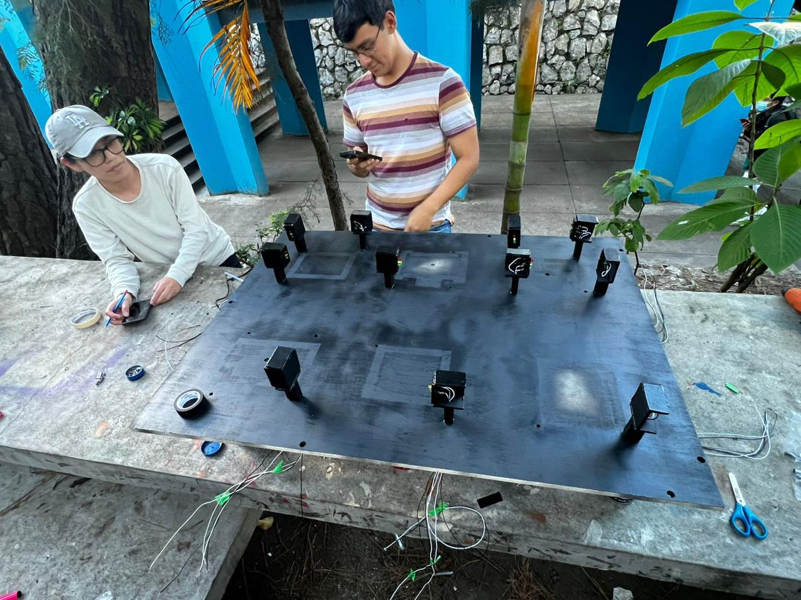
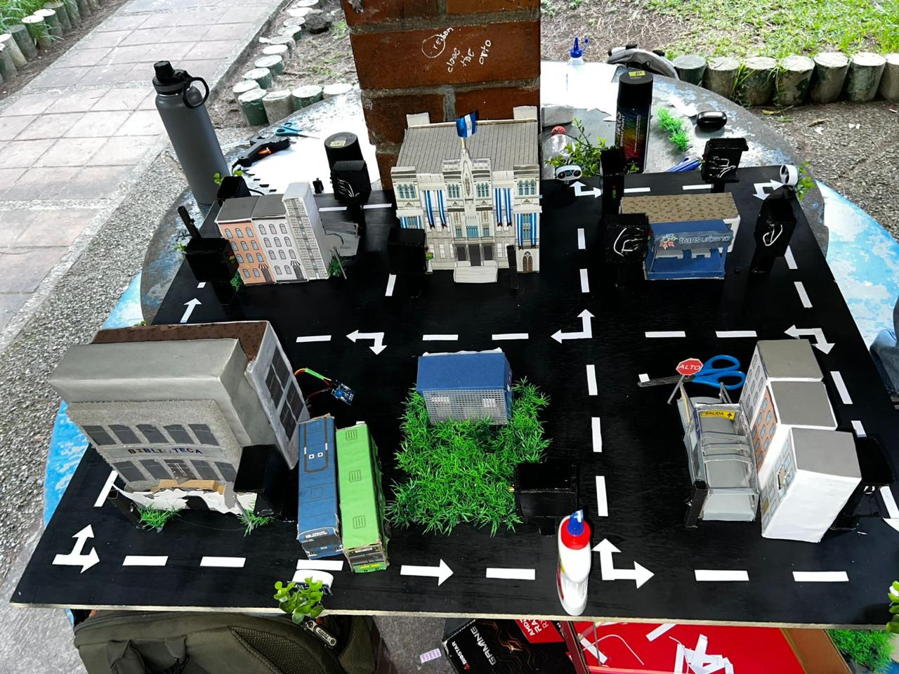

---

## **Reporte Semanal – Semana 3**

**Objetivo de la semana:**
El objetivo principal de esta semana fue reemplazar la base y superficies de la maqueta debido a que el carton utilizado inicialmente se deterioro con las perforaciones y el transporte recurrente lo que generaba desconexiones frecuentes de los sensores y daños estructurales para resolverlo se opto por trasladar toda la maqueta a una base de madera lo que nos garantizo mayor estabilidad y tambien mejora en la parte estetica.

Ademas se busco terminar la decoracion general y realizar nuevamente procesos esenciales como:

* Volver a cablear todos los componentes
* Perforar la nueva base para los sensores y cableado
* Pintar la madera de color negro
* Señalizar calles edificios y paradas de trasmetro y trasurbano
* Asegurar la integracion completa del sistema electronico con la maqueta fisica

---

### **Resumen general de avances**

Durante esta ultima semana el equipo logro consolidar el proyecto y dejarlo listo para la entrega final y para proceder al dia de la calificacion.

Los avances mas relevantes fueron:

* **Cambio de maqueta:** Se sustituyo la estructura de carton por una base de madera algo  que aporto mayor resistencia y durabilidad aparte de mas estetica por lo solida que se ve .

* **Recableado completo:** Se reinstalaron todos los sensores, LEDs y botones en la nueva superficie lo cual  resolvio el problema de longitud de cable mediante un alargamiento de estos mismos.

* **Decoracion y señalizacion:** Se repinto la base en color negro y se redistribuyo la decoracion (edificios, paradas y señalizacion vial) para adaptarla a la nueva estructura.

* **Pruebas de funcionamiento:** Se realizaron pruebas finales en la maqueta verificando la correcta operacion de los sensores, LEDs, buffers y botones logrando un sistema funcional en su totalidad.

* **Ajustes en software y electronica:** Se corrigieron pequeños problemas de conexion y verificacion en el codigo de Arduino y Processing confirmando que toda la logica de control funcionara bien esto nos aseguro que al momento de porbarlo de forma fisica no diera muchos fallos.

Con estos avances el proyecto quedo totalmente terminado listo para ser presentado.

---

### **Aportes individuales**

#### **DANIEL ANDREE HERNANDEZ FLORES**

* Apoyo en el traslado del circuito principal a la nueva base de madera
* Conecto y verifico los sensores de movimiento tras el recableado
* Realizo pruebas de funcionamiento general en Arduino

#### **EDUARDO SEBASTIAN GUTIERREZ FELIPE**

* Coloco y probo los LEDs de los semaforos en la nueva maqueta
* Aseguro la correcta sincronizacion de los semaforos en el circuito principal
* Ajusto el cableado para evitar desconexiones durante las pruebas

#### **ABDIEL FERNANDO JOSÉ OTZOY OTZiN**

* Encargado de probar la comunicacion en Processing despues del cambio de base
* Verifico que las alertas visuales funcionaran al recibir datos de Arduino
* Apoyo en la redistribucion del cableado interno en la nueva estructura

#### **GABRIEL ANDRES MELGAR ARAGON**

* Superviso la reinstalacion de los sensores de gas y presion en la base de madera
* Apoyo en la extension de cables que no alcanzaban al circuito principal
* Realizo pruebas de continuidad eléctrica para confirmar la correcta conexion

#### **CHRISTIAN DAVID CHINCHILLA SANTOS**

* Coordino la reconstruccion de la maqueta sobre madera
* Pinto  la base en color negro
* Redistribuyo elementos decorativos para no interferir con los sensores

#### **ENGEL EMILIO COC RAXJAL**

* Coloco nuevamente las paradas y rutas de transporte en la maqueta de madera
* Señalizo calles y ubicaciones de interes
* Apoyo en la conexion y pruebas de los botones de panico

#### **JHONATAN IVAN GUOZ TUBAC**

* Apoyo en la decoracion final de la maqueta adaptando los edificios a la nueva base
* Reforzo estructuras para evitar caidas de sensores durante el transporte
* Hizo las mediciones para colocar cada edificio y señalizo donde tenian que ir las calles en la estructura 

#### **DANIEL ABRAHAM ORTIZ CHINCHILLA**

* Conecto y probo los sensores ultrasonicos en la base de madera
* Reviso el correcto funcionamiento de los semaforos tras el recableado
* Apoyo en el montaje definitivo de LEDs y botones

#### **BRYAN JOSUÉ CORONADO LAINEZ**

* Documento el proceso de reconstruccion y pruebas en la nueva maqueta
* Reviso y corrigio errores de conexion en el circuito principal
* Apoyo en las pruebas de integracion final Arduino + Processing

---

### **Dificultades encontradas**

* La reconstruccion completa de la maqueta por el cambio de material esto implico repetir procesos de cableado, perforacion y decoracion

* Problemas con la pintura acrilica que no adheria bien a la madera lo cual se resolvio usando pintura en aerosol

* Redistribucion de decoraciones y cableado para adaptarse a la nueva estructura y no interferir con sensores

* Mayor dificultad en el transporte de la maqueta debido a su peso incrementado por la madera

* Desconexiones y soldaduras fragiles en algunos sensores que requirieron ajustes durante las pruebas

* Interferencia de algunos elementos decorativos con los sensores de movimiento lo que obligo a reubicar la decoracion

* Errores de conexion por la gran cantidad de cables lo que provoco fallas y requirio una revision detallada que nos consumio bastante tiempo.

---

### **Tareas pendientes para la proxima semana**

El proyecto quedo finalizado y totalmente funcional por lo que no hay tareas pendientes inmediatas unicamente queda reforzar la decoracion y realizar mejoras estéticas adicionales para la siguiente fase.

---

### Evidencia Fotografica

---