# Reporte del Modelo 3D Impreso  

## 1. Introducción  
Este documento presenta el proceso y los resultados de la impresión 3D de los componentes seleccionados para el proyecto. El objetivo principal fue materializar en piezas físicas los modelos digitales diseñados previamente, de manera que puedan ser integrados a la maqueta de la **Zona 1 de la Ciudad de Guatemala**.  

## 2. Descripción del modelo 3D impreso  
Se imprimieron dos elementos clave del entorno urbano:  
- **Postes de luz**: diseñados para portar luces LED y simular el sistema de alumbrado público.  
- **Mercado 3D**: estructura representativa del comercio local, modelada digitalmente y fabricada en filamento PLA.  

Estas piezas permiten añadir realismo y funcionalidad al prototipo, además de servir como base para la integración de tecnología IoT.  

## 3. Proceso de impresión  
- **Exportación de archivos**: los modelos digitales fueron convertidos a formato STL.  
- **Parámetros de impresión**:  
  - Altura de capa: 0.2 mm  
  - Material: Filamento PLA  
  - Relleno: 20%  
  - Impresora: FDM estándar  
- **Ensamblaje posterior**: los postes se adaptaron para la instalación de LEDs, mientras que el mercado fue ensamblado en la maqueta como estructura central.  

## 4. Imágenes del modelo impreso  

### Postes de luz impresos  
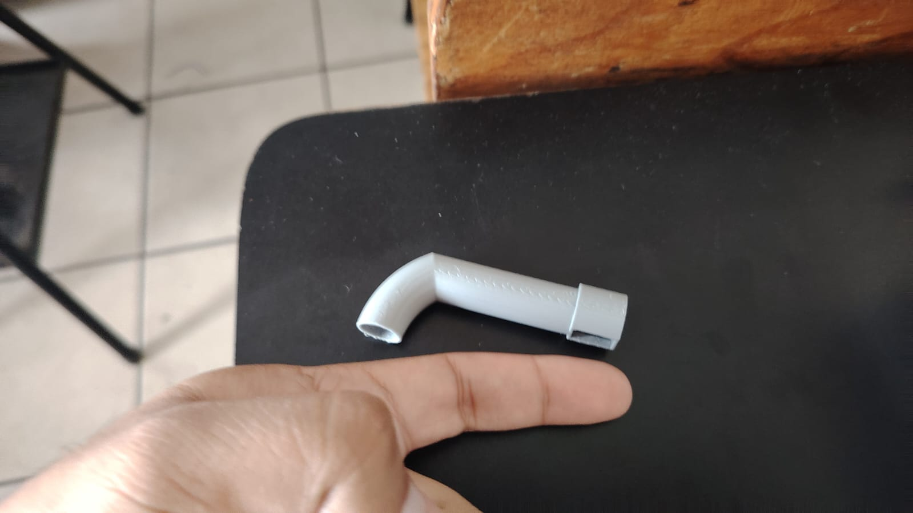  
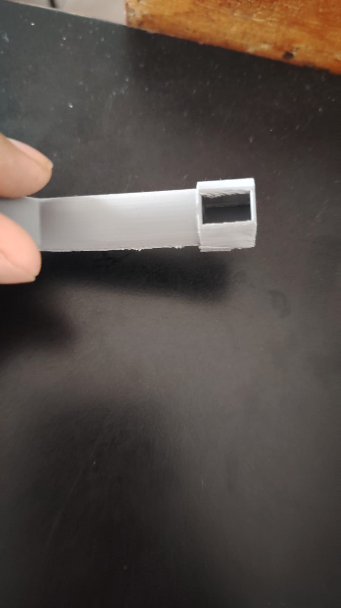  
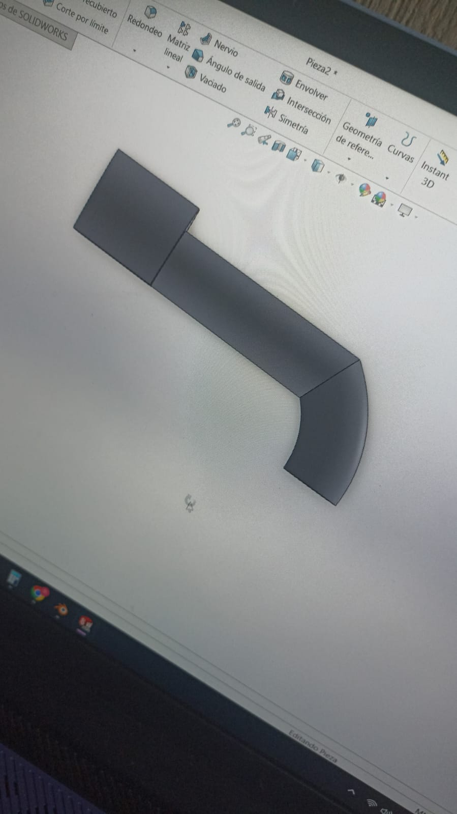  
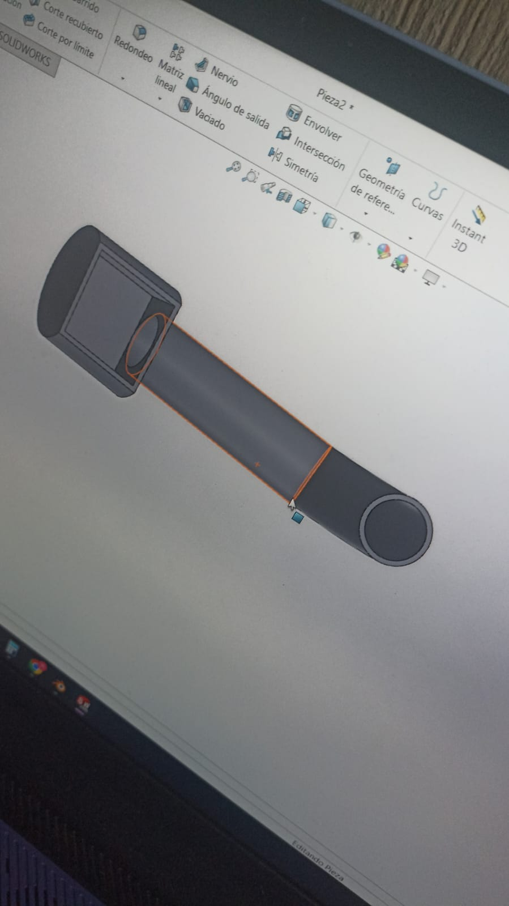 
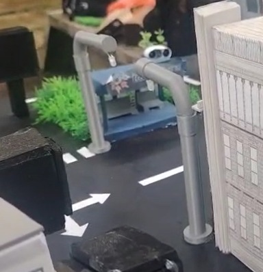
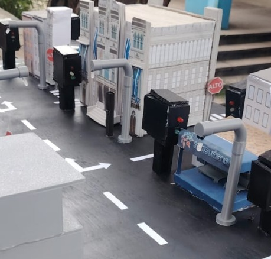
Prototipo del poste de luz una vez impreso, mostrando su estructura lista para la integración de LEDs. 

### Mercado 3D impreso  
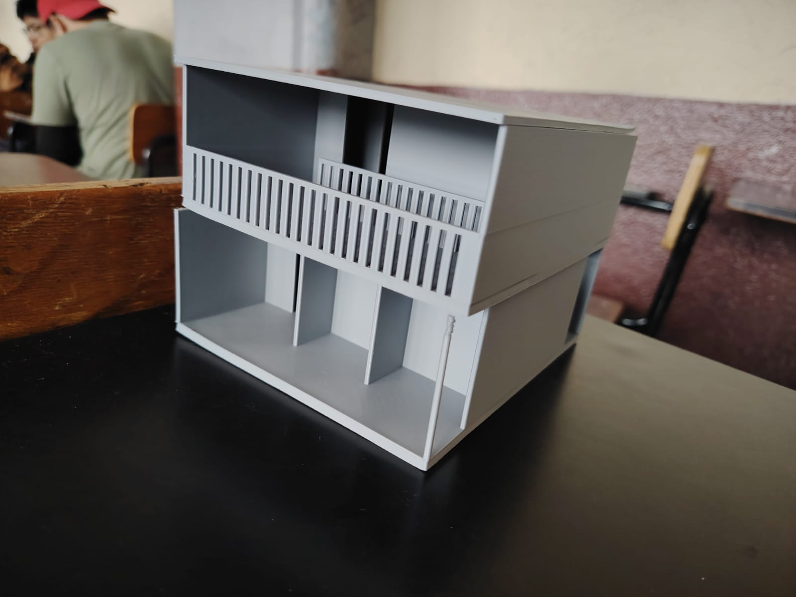 
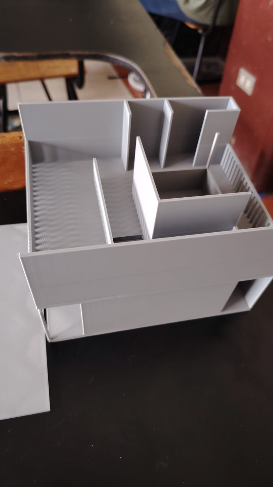 
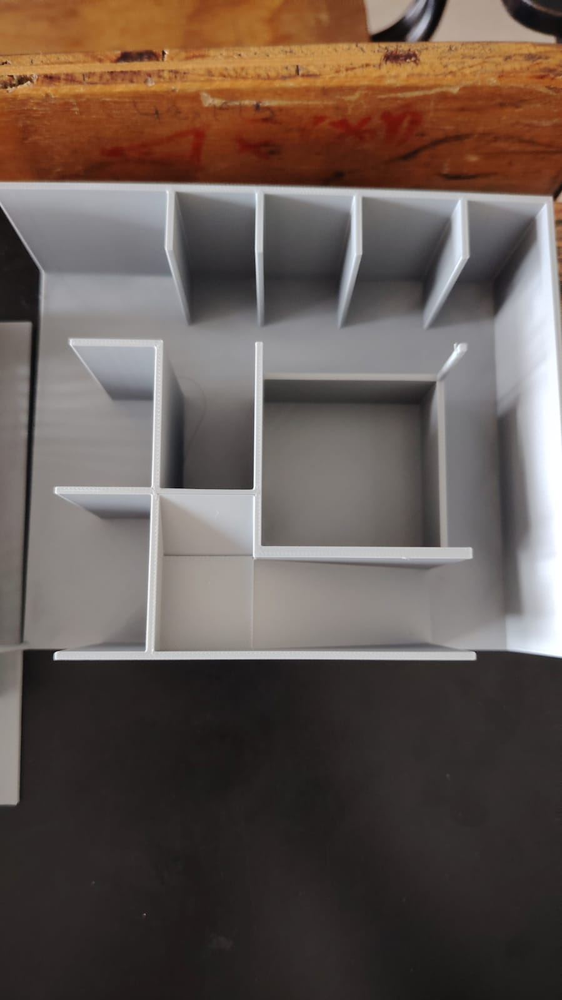 
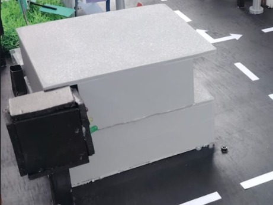 
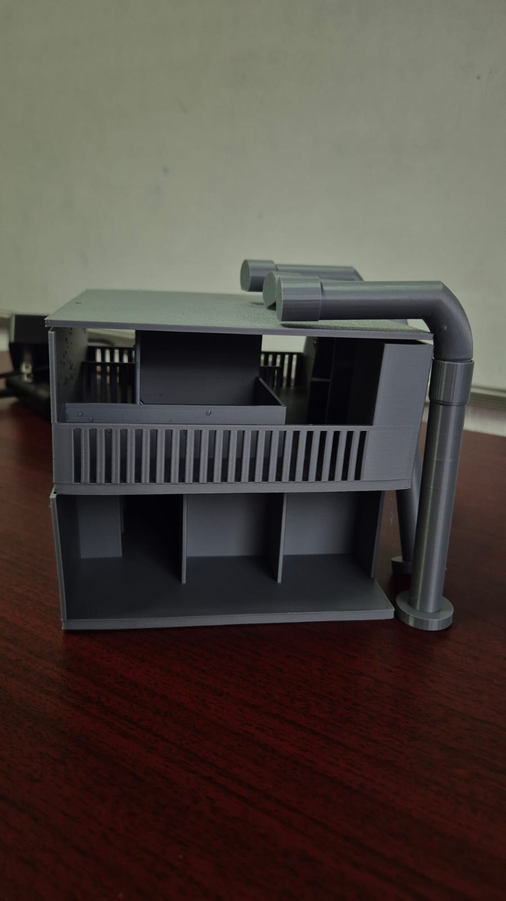 
Estructura impresa del mercado, donde se aprecia la forma y los detalles principales del diseño original.  

---

## 5. Resultados  
- Los **postes de luz impresos** demostraron ser resistentes y adecuados para la integración de sistemas de iluminación LED.  
- El **mercado impreso en 3D** representó de manera fiel el diseño digital, destacando la cubierta, las áreas de venta y el mobiliario interior.  

## 6. Conclusiones  
La impresión 3D permitió transformar los modelos digitales en elementos físicos, logrando un equilibrio entre representación estética y funcionalidad. Este proceso no solo facilitó la construcción de la maqueta, sino que también aportó una base tangible para futuras pruebas con sensores y sistemas de monitoreo inteligente.
