# Reporte del Prototipo Físico

## 1. Introducción  
El presente reporte documenta el prototipo físico desarrollado como parte del proyecto. Diseñada para ofrecer una representación más realista del entorno en el que se implementará un sistema de monitoreo de seguridad basado en IoT.  
Al incorporar elementos físicos como infraestructura vial y edificaciones, la maqueta permite visualizar de manera tangible cómo se desplegaría el sistema en un contexto urbano real.  

## 2. Descripción del prototipo  
Para incrementar el realismo, el prototipo integra componentes impresos en 3D que representan elementos clave del paisaje urbano. En particular, se imprimieron **postes de luz** a los cuales se les incorporaron luces LED para simular el sistema de alumbrado del área. Además, se elaboró una **estructura de mercado en 3D**, fabricada con filamento PLA. La combinación de elementos de iluminación y arquitectura hace que el prototipo sea tanto funcional como representativo del entorno real.

## 3. Imágenes  

A continuación se presentan las imágenes correspondientes al diseño del **poste de luz** que forma parte del prototipo físico.

### Lado horizontal donde porta la LED  
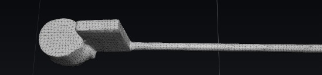  
En esta vista se observa el extremo horizontal del poste, diseñado específicamente para portar la lámpara LED que permitirá la simulación del alumbrado público.  

### Lado vertical del prototipo  
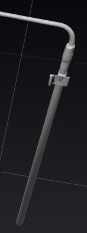  
Se muestra la estructura vertical del poste de luz, que representa la base de soporte del componente físico.  

### StreetLamp  
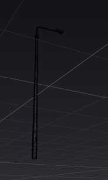  
Vista general del poste de luz completo, modelado en 3D para su impresión y posterior integración al prototipo físico.  

### StreetLight  
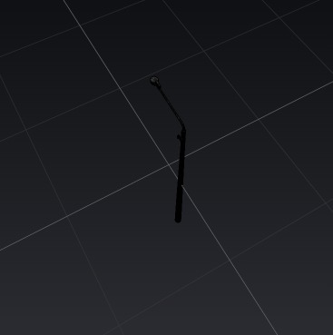  
Perspectiva lateral del diseño, donde se aprecia la proporción y altura del poste en relación con el entorno de la maqueta.  

### Env_LampPost_A  
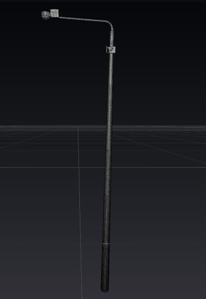  
Otra representación del poste de luz en su versión final modelada, lista para impresión 3D.  

### Vértices, Metafaces, Topologías  
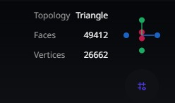  
Datos técnicos del modelo 3D: se muestran los vértices, caras y topología triangular empleados en la construcción digital de la pieza, con un total de **26,662 vértices** y **49,412 caras**.

## 3.2 Mercado 3D

El siguiente conjunto de imágenes muestra el diseño del mercado, una de las estructuras principales incluidas en la maqueta de la Zona 1. Este modelo busca representar los espacios comunitarios y comerciales característicos de la zona.

### Env_Building_A  
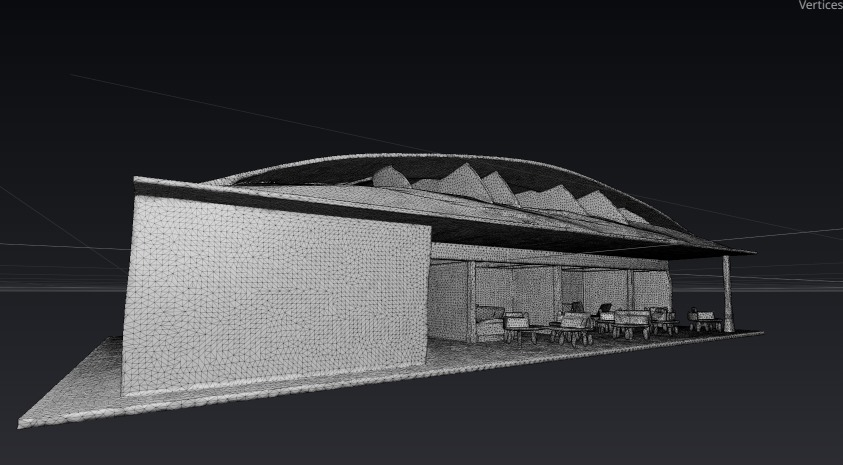  
Vista general del edificio del mercado en su estructura principal, donde se aprecia el diseño completo en su estado tridimensional.  

### Techo  
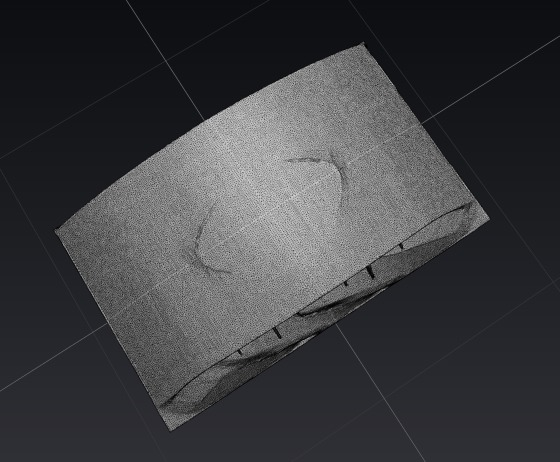  
Imagen superior que muestra la cubierta del mercado y su geometría.  

### Primer piso  
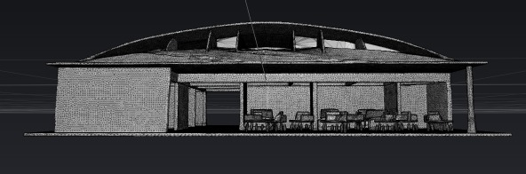  
Vista frontal del primer nivel del mercado, en el que se distinguen accesos y espacios abiertos para los puestos de venta.  

### Sillas  
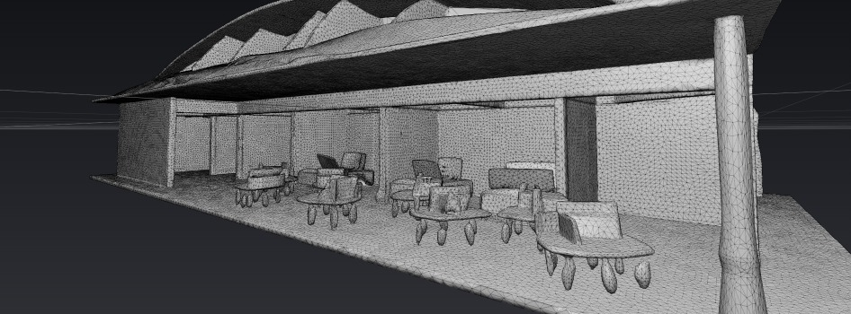  
Detalle interior del mercado con la disposición de mesas y sillas, representando las áreas de consumo.  

### Lado horizontal  
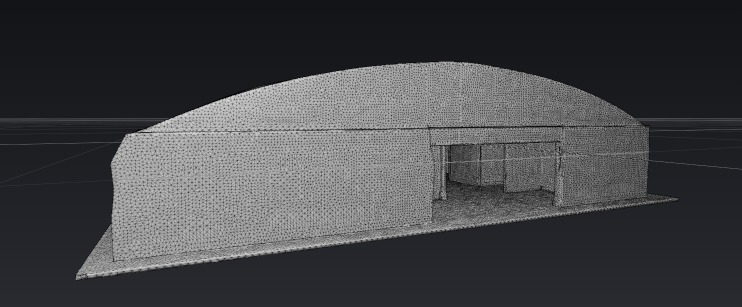  
Perspectiva lateral del edificio que evidencia su extensión y muros perimetrales.  

### Vertical  
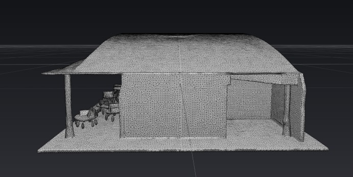  
Vista trasera y vertical del mercado, donde se observa la entrada y la proyección de su estructura.  

### Topología, Faces, Vértices del mercado  
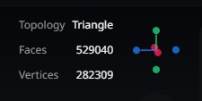  
Datos técnicos del modelo 3D: se presentan los detalles de la topología triangular empleada, con un total de **282,309 vértices** y **529,040 caras**.

