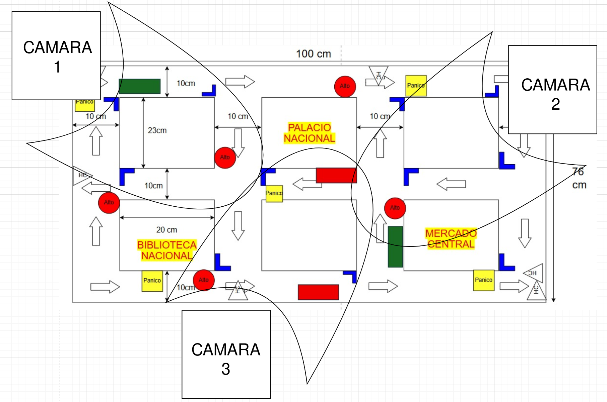

# Sistema Inteligente de Seguridad y Gestión de Tráfico Urbano – Fase 3

## Descripción General
Este prototipo físico representa la implementación funcional del **Sistema Inteligente de Seguridad y Gestión de Tráfico Urbano**, desarrollado con tecnologías **IoT** e **Inteligencia Artificial (IA)**.  
Integra hardware, software y visión por computadora para el monitoreo del tráfico, detección de infracciones y alertas de seguridad en tiempo real.

