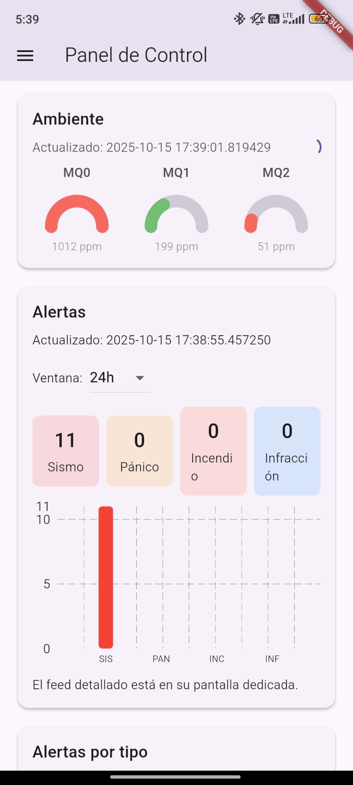
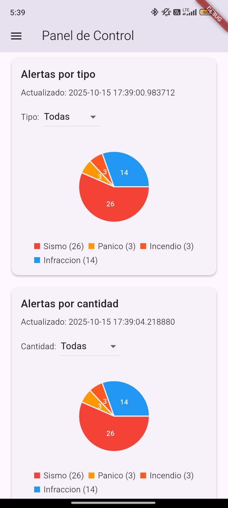
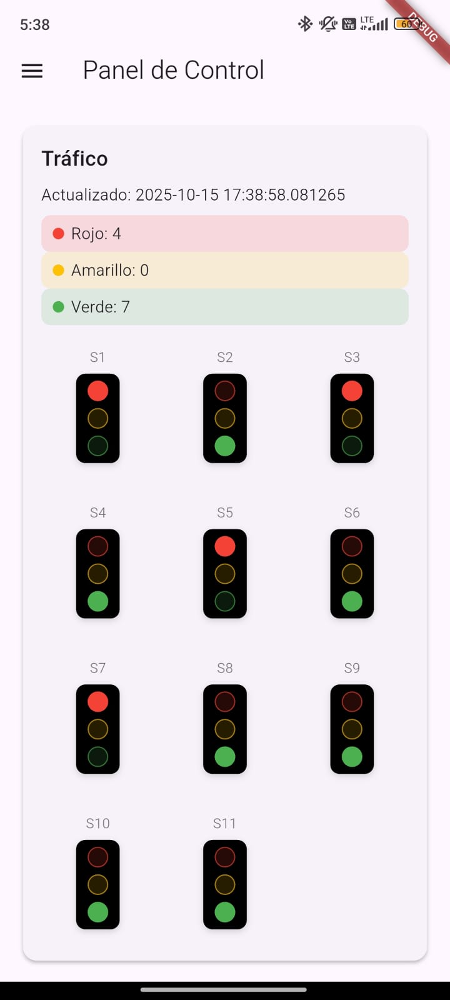
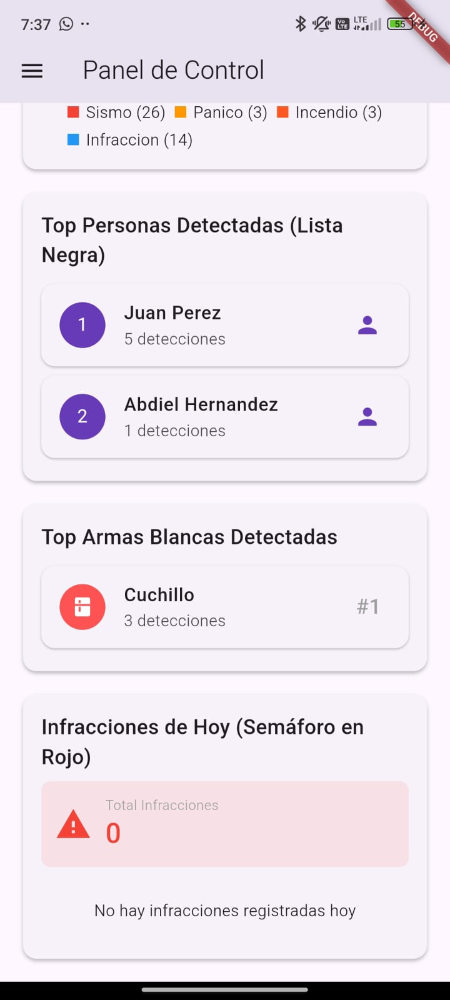
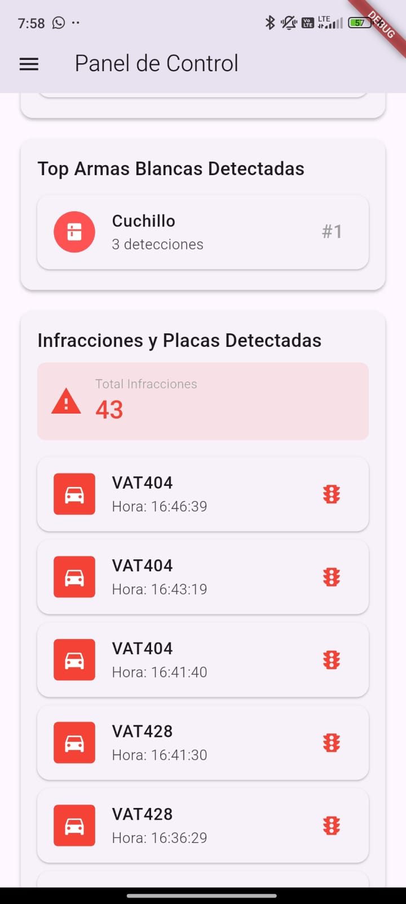
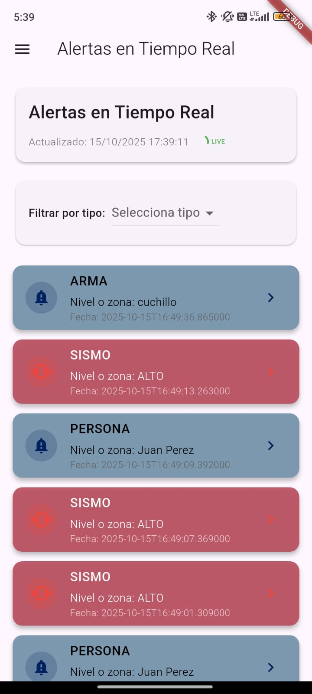
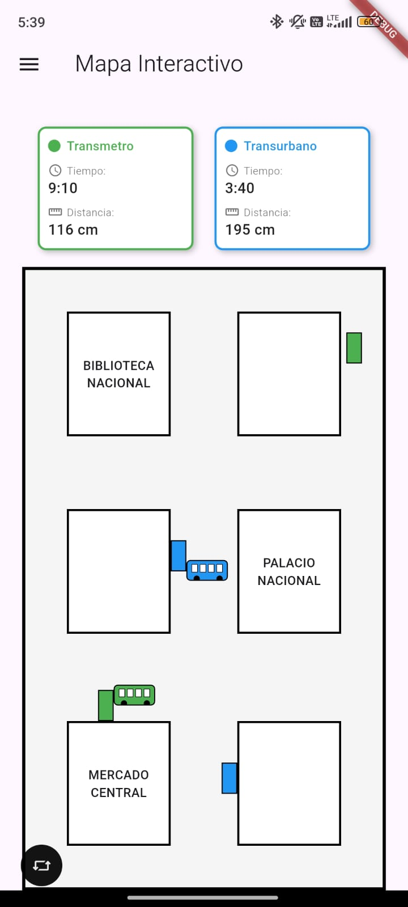

# Manual de usuario
## Este documento proporciona una guía completa para los usuarios del sistema.

### Panel de control
En este apartado el usuario podrá ver la calidad del aire en el ambiente esto en partes por millon (ppm).

Alertas que han habido durante cierto tiempo (en la imagen aparece en las ultimas 24 horas pero tiene mas opciones), indicando la cantidad de alertas que han habido en ese tiempo, tambien muestra cuando fue la ultima vez que se actualizo el conteo.

Tambien muestra los tipos de alerta que han habido

El usuario podrá ver ciertas alertas las cuales tienen que ver con el tipo de alerta (sismos, panico, incendio, Infracción), tambien verá la ultima actualización del sistema.

Tambien contará con un apartado para ver la cantidad de alertas que hubieron clasificadas por (sismos, panico, incendio, Infracción).

Tambien se podrá ver el estado del trafico y en que momento ha sido el ultimo reporte del trafico, tambien podrá ver el estado de cada semaforo segun su zona (1,2,3,4,5,6,7,8,9,10,11) ya sea en verde, amarillo o rojo.

Tambien podra ver un top de una lista negra de las personas detectadas cometiendo atrosidades (robos, asaltos, etc) y la cantidad de detecciones que tiene esa persona.

Tambien podrá ver el top de las armas blancas detectadas en el sistema.

Tambien se podrá ver la cantidad de infracciones que han habido el dia actual (semaforos en rojo cruzados).

Tambien se podrá ver lo que es la cantidad de infracciones y placas detecadas pudiendo ver las placas que se han detectado en el dia actual.

### Alertas en tiempo real
La persona podrá ver en tiempo real que hubo y por quien fue reportado pudiendo filtrar el tipo de alerta que hubo.

### mapa interactivo
El usuario podrá ver un mapa interactivo en el cual podrá ver en que posiciones estan los transmetros y los transurbanos, tambien pudiendo ver el tiempo en el que salieron y la distancia que tienen.
